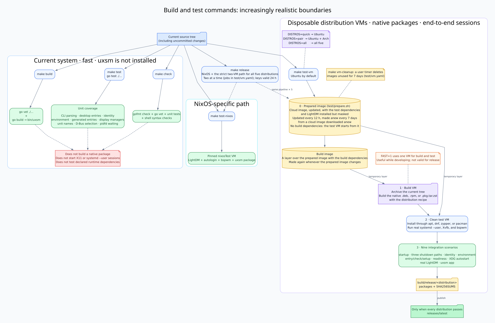

# Developing uxsm

This document is for contributors and package maintainers. For runtime behavior, see [Architecture](architecture.md). For user-facing failure diagnosis, see [Troubleshooting](troubleshooting.md).

## Build and test



[DOT source](flows/build-and-tests.dot)

The important distinction is the boundary each command tests:

| Command | Where it runs | What it proves |
| --- | --- | --- |
| `make test` | Current system, without installing uxsm | Isolated Go behavior. |
| `make test-vm` | Disposable VMs | The installed native package with X11 and `systemd --user`. |

`make test-vm` is not the unit suite on another distribution. It builds the native package in one VM, installs it in a second clean VM, and exercises complete sessions there.

uxsm uses only the Go standard library. Common commands are:

```sh
make build   # go vet, then bin/uxsm
make test    # Go unit tests
make check   # formatting, vet, unit tests, and shell syntax
make test-vm # Ubuntu by default
make test-vm DISTROS=pair
make test-vm DISTROS=all
make test-vm FAST=1 # build and test in one VM
make test-vm DISTROS=nixos,arch
make test-nixos # NixOS VM declared by the flake
make release    # strict VM path for every distribution
```

### Unit tests

`go test ./...` covers behavior that does not require privileges or a real graphical session:

- command dispatch and entry-versus-command parsing;
- XDG lookup and parsing of `.desktop` entries, including `Exec=` quoting;
- session identity, runtime files, and environment-file loading;
- environment changes and exact restoration;
- session-entry generation and round trips;
- LightDM, SDDM, and GDM configuration on a fake filesystem;
- unit names, session-bus detection, and `pidfd` waiting.

### Integration tests

[`test/release.sh`](../test/release.sh) archives the current working tree, including uncommitted changes, and drives disposable QEMU machines through [`test/vm.sh`](../test/vm.sh). Each distribution is a run of its own, with two VMs:

1. a build VM creates the native package with the real recipe under `packaging/`; and
2. a clean VM installs that package through the distribution package manager and runs the suite.

Runs go two at a time (`jobs` in [`test/vm.yaml`](../test/vm.yaml), set by hand rather than taken from the machine), each with its own SSH port, and after the first failure no further run starts. `make release` runs NixOS first, as it catches what the others cannot and takes under a minute, then the slowest first, so that the last run to start is a short one. Ubuntu and Arch side by side took 2:45 against about 3:45 one after the other. A package is rebuilt only when the files that go into it change, so the installation and the tests can be adjusted without building from scratch; a new commit always rebuilds it, as its version carries the commit hash.

Both VMs start from a prepared image of their distribution, kept in `~/.cache/uxsm/vm`: the official cloud image, updated, with the test dependencies installed by [`test/prepare.sh`](../test/prepare.sh), LightDM among them but masked, so that the tests before the display manager's see a machine without one. Each VM writes to a temporary layer over it, so the clean VM stays clean and neither downloads what the other already did. Build dependencies stay out of the image, as they would hide a runtime dependency the package forgot. Each update drops the downloaded packages and writes the image anew without the blocks the guest freed, so it does not grow with every update. The build VM starts from a second image, a layer over that one with the build dependencies, made again whenever the prepared image changes: the recipe still installs them, which then takes a few seconds, so a new dependency is never missed. The cloud image goes once the prepared image is made, as remaking that one downloads it anew anyway. [`test/vm.yaml`](../test/vm.yaml) says when an image is updated (12 hours) and when it is made again from a cloud image downloaded anew (7 days); `UXSM_VM_FRESH=1` starts from the cloud image instead.

`test/vm.sh` replaces the images but never deletes them, and they take several gigabytes. `make vm-cleanup` installs a systemd user timer that runs [`test/vm-cleanup.sh`](../test/vm-cleanup.sh) once a day, at low priority, to delete the images unused for 7 days, or for whatever `cleanup` says in `test/vm.yaml` (`1d`, `8h`, or `boot`, for those not used since the computer started). It never deletes while a VM is running. `make vm-cleanup-remove` takes the timer away.

Each run writes its complete output to `build/logs/<distribution>/<time>/run.log`, with the time of each step, and a summary of how long each step took to `times` beside it. The terminal shows only the steps, failures, and that summary. A failed VM also leaves its console and journal there. The ten latest runs of each distribution are kept, and nothing there is uploaded.

Downloads from the distribution's repositories that uxsm does not decide, such as index refreshes, system updates, and the build and test tools, go through [`test/mirror.sh`](../test/mirror.sh): a rolling distribution's mirror caught halfway through a sync is retried in the same VM for about a quarter of an hour, and if it still fails the run ends as `MIRROR`, not `FAILED`. What the recipe asks for, including the uxsm package and its dependencies, is not retried, because there a failure may be uxsm's.

The scripts under `test/integration` use Xvfb and normally replace the display manager with a transient service. The last test installs and starts LightDM instead.

| Script | Coverage |
| --- | --- |
| `01-desktop-service.sh` | Entry and direct-command startup; the desktop is the service's main process. |
| `02-session-shutdown.sh` | Desktop exit, login-process death, and `uxsm stop`. |
| `03-session-identity.sh` | `DesktopNames=`, `-D`, `-e`, and XDG variables. |
| `04-session-environment.sh` | `env*` loading and exact restoration through all shutdown paths. |
| `05-generated-entries.sh` | Installation, overwrite protection, `check`, and `setup`. |
| `06-session-ready.sh` | Both readiness signals and the timeout path. |
| `07-xdg-autostart.sh` | Autostart, `--no-autostart`, generated entries, and application slices. |
| `08-display-manager.sh` | A real LightDM session with autologin over Xvfb. |
| `09-app.sh` | `uxsm app` units, slices, entries, actions, properties, and shutdown. |

The supported matrix is Ubuntu 24.04, Debian 13, Arch Linux, Fedora 43, and openSUSE Tumbleweed. `DISTROS=quick` selects Ubuntu, `pair` selects Ubuntu and Arch, and `all` selects all five.

With `FAST=1`, one VM builds and tests the package. On Ubuntu this reduced a measured run from 4:07 to 3:37, but it cannot detect undeclared runtime dependencies because build dependencies remain installed. Use it while developing, not when publishing. `make release` always uses separate build and test VMs.

`make release` runs NixOS and the five distributions. A run that passes leaves a key in `build/keys`, valid while the tested files stay the same and for 24 hours, since Arch and Tumbleweed change daily. Runs with a valid key are skipped, so after a failure only what failed is repeated, and one distribution passing never invalidates another. Once all six have a key, `build/release` becomes `releases/latest`. A `FAST=1` run leaves no key.

### NixOS

`make test-nixos` starts a complete declarative NixOS machine with LightDM, autologin, bspwm, and an uxsm session entry. It verifies that the session starts, the desktop is the service's main process, the XDG identity is present, and stopping the display manager tears everything down.

The definition is [`test/nixos/session.nix`](../test/nixos/session.nix) and is exposed through the flake's `checks`. It requires Nix and a running Nix daemon, just as the other VM tests require QEMU. `flake.lock` pins nixpkgs so the test machine remains reproducible. This test covers the NixOS layout and packaging path, which differ from conventional distributions. It is not optional: `make release` runs it as its first distribution, so publishing from a machine without Nix fails there instead of shipping a release that skipped a sixth of the tests, and CI runs it as its own job on `main` and on every version tag.

### Continuous integration and hooks

[`.github/workflows/ci.yml`](../.github/workflows/ci.yml) runs `make check` and `make build` on every push and pull request. On `main`, on version tags, and through `workflow_dispatch` (with the distribution set as an input), it also runs one VM job per distribution, each on its own runner, plus the NixOS machine; GitHub-hosted runners expose `/dev/kvm`, and a distribution takes three to five minutes there. The VM jobs check out the whole history so that packages carry the real version, and every job keeps its logs, passed or failed, including the console and journal of a failed VM, as an artifact for 14 days.

The VM jobs start from the cloud images, as a runner would make a prepared image only to throw it away: measured on 2026-10-16, making it there took the run from 5m17s to 6m51s, since it updates the whole system. For a series of pushes close together, `gh variable set UXSM_VM_CACHE --body 1` keeps the prepared images in GitHub's cache between runs, and `gh variable delete UXSM_VM_CACHE` turns that off again; the next run then empties the cache. It is off by default because the images take several gigabytes of the repository's 10 GB.

The pre-commit hook runs `gofmt`, `go vet`, unit tests, and `sh -n` over shell scripts. The pre-push hook requires a successful `make release` for the exact commit pushed to `main`, `master`, or a `vX.Y.Z` tag; without one it stops and asks for it, rather than running it, because the remote closes the connection git opened before a release that long finishes. Enable both with:

```sh
make hooks
```

## Source map

| Path | Role |
| --- | --- |
| `cmd/uxsm` | Public CLI and internal subcommands called by systemd units. |
| `internal/desktopentry` | XDG lookup and desktop-entry parsing. |
| `internal/session` | Session identity and runtime exchange files. |
| `internal/sessionenv` | Environment preparation and restoration. |
| `internal/sessionentry` | Known desktop table and entry generation. |
| `internal/systemd` | `systemd --user` and D-Bus operations. |
| `internal/dm` | Display-manager detection and configuration. |
| `internal/appunit` | Unit names, slices, and commands for `uxsm app`. |
| `internal/autostart` | Runtime drop-in that moves XDG autostart into the session slice. |
| `internal/pidwait` | `pidfd`-based waiting for external processes. |
| `internal/x11` | Direct X11 communication used to detect the window manager. |
| `data/systemd/user` | Installed systemd user-unit templates. |
| `data/man` | Manual-page source and its build-time substitutions. |
| `test` | Integration scripts, VM orchestration, packages, and distro session data. |
| `packaging` | Native package recipes exercised by release tests. |

## Publishing a release

`make release` builds and tests; `make publish TAG=vX.Y.Z` publishes. They are separate because the release build is also a test gate used during development, while publishing is a public, irreversible action.

`test/publish.sh` follows this order and stops at the first failed precondition or command:

1. **Checks.** The version has the form `vX.Y.Z`, the tree is clean, the branch is `main` or `master`, the tag is unused locally and remotely, no GitHub release has that name, and `gh` is logged in.
2. **The local tag.** It must precede the build because `test/version.sh` derives the version from `git describe`; packages and tarballs contain `X.Y.Z` only after the tag exists. If `releases/latest` does not contain that version, `make release` runs now.
3. **The binary tarball.** It is placed beside the packages and included in a new `SHA256SUMS`. Before publication, the script installs the tarball into a temporary root and checks the installed binary's version. A tarball that cannot install itself is never published.
4. **The push and GitHub release.** The commit and tag are pushed, then `gh release create` uploads the five packages, source tarball, binary tarball, and `SHA256SUMS`.

Everything through step 3 remains local, and the tag can still be removed with `git tag -d`. Step 4 asks for confirmation unless `--yes` is used. `DRY_RUN=1` still performs read-only checks, but executes no state-changing command and prints each one it would run.

Afterwards, `test/publish.sh --hashes vX.Y.Z` downloads GitHub's tag archive and writes its checksum to `packaging/arch/PKGBUILD` and `packaging/nix/package.nix` for publication in the AUR and nixpkgs. This cannot happen earlier because GitHub creates and compresses that archive itself; its checksum is knowable only after the tag is available there.

## The manual page

`data/man/uxsm.1.in` is the source of `uxsm.1`. `make install` writes it under `$(MANDIR)/man1` and replaces `@VERSION@` and `@BINDIR@`, just as it fills in the unit templates. Arch and Debian obtain the page through that installation; the Fedora, openSUSE, and Nix recipes list it explicitly.

`make check` lints it with `groff -man -z -ww`. Because groff exits successfully even after a warning, the check separately fails on any standard-error output; this catches problems such as an unknown macro or an unclosed section. The integration suite verifies installation: `test/integration/run.sh` fails if a package omits `man/man1/uxsm.1`, regardless of the compression used by that distribution.

## Go version

### Why Go 1.22

The minimum version is Go 1.22 because Ubuntu 24.04 LTS ships it. Requiring a newer version would prevent that distribution from building the package with its native toolchain.

Versions checked on 2026-09-17:

| Distribution                                    | Go version       |
| ----------------------------------------------- | ---------------- |
| Ubuntu 24.04 LTS                                | 1.22             |
| Debian 13 (trixie)                              | 1.24             |
| Ubuntu 26.04 LTS                                | 1.26             |
| Fedora 43                                       | 1.26             |
| Arch Linux, openSUSE Tumbleweed, NixOS unstable | Latest available |

The `.0` in `go.mod` is intentional: `go 1.22` names a language version, not a released Go toolchain. An older Go release attempting automatic toolchain selection needs the full version.

### Why `go vet` runs before every build

A Go version newer than the one declared in `go.mod` can compile calls added to the standard library after Go 1.22. `go vet` catches those compatibility mistakes, so `make build` runs it first.

### APIs unavailable at the minimum version

| Added in | Do not use |
| --- | --- |
| Go 1.23 | Range-over-function iterators; `iter`; `slices.Collect`; `slices.Sorted`; iterator forms of `maps.Keys` and `maps.Values`; `unique`. |
| Go 1.24 | Generic type aliases; `os.Root`; `strings.Lines`; `strings.SplitSeq`; `testing.B.Loop`; JSON `omitzero`. |
| Go 1.25 | `sync.WaitGroup.Go`; `testing/synctest`. |

Go 1.22 features are available, including integer ranges, per-iteration loop variables, `min`, `max`, pre-iterator `slices` and `maps`, `math/rand/v2`, and `log/slog`.
